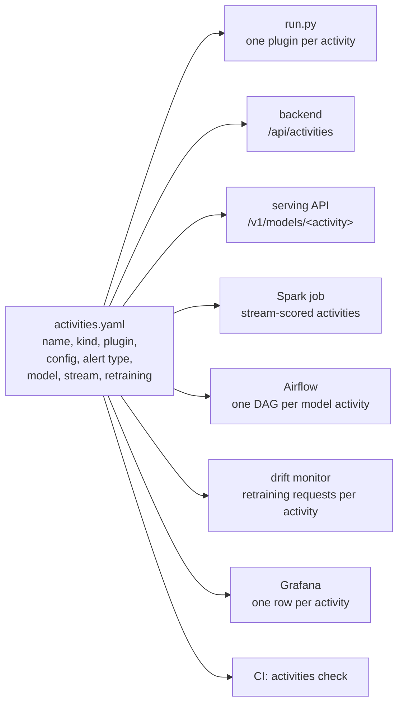

# Activities: the plugin framework (Phase 9)

Every suspicious activity the system detects is declared once, in [`activities.yaml`](../activities.yaml). Every part
of the pipeline reads that file, so adding an activity never means editing the detector loop, the serving API, the
retraining pipeline or the dashboards by hand.



## 1. What is registered

```text
$ python -m rover_ai.activities list
loitering    on  rule  alert 'loitering'  ->  edge
access       on  rule  alert 'restricted'  ->  edge
fight        on  model alert 'fight' model fight-detector  ->  edge, serving /v1/models/fight, stream, Airflow fight_retraining
theft        on  rule  alert 'theft'  ->  edge
crowding     off rule  alert 'crowding'  ->  edge
```

| Field | Meaning |
|---|---|
| `kind` | `rule` (hand-written logic, no training) or `model` (a trained model from the MLflow registry) |
| `plugin` | `module:Class`, a subclass of `rover_ai.plugins.ActivityPlugin` |
| `config` | the `config.yaml` section with its settings and its `enabled` switch |
| `alert_type` | the `type` of its alerts (backend, dashboard, Grafana, labels) |
| `model` | model activities: `registered_name` (MLflow), `input` (`person_pair` / `person` / `scene`), `window_frames`, `train_stage` (DVC) |
| `stream` | scored by the Spark job on the server (the edge then skips it while Kafka is up) |
| `retraining` | model activities: Airflow DAG id, schedule, `on_drift`, `min_new_labels`, `max_age_days`, `prepare` command, DVC `stages` |

## 2. Who reads it

| Part | What it takes from the registry | Code |
|---|---|---|
| Edge detector | builds one plugin per enabled activity, in registry order; the frame loop only calls `plugin.update(ctx)` | `run.py`, `rover_ai/plugins.py` |
| Stream hand-over | activities with `stream: true` are skipped on the laptop while the stream scores them | `rover_ai/streaming.py` |
| Backend | the list of activities and alert types (`GET /api/activities`) | `backend/app.py` |
| Serving API | loads the `@champion` of every model activity (unless `SERVING_MODELS` overrides it) | `serving/app.py` |
| Spark job | logs which activities it scores; one without a scorer is reported | `streaming/spark_job.py` |
| Retraining | one DAG per activity with `retraining` (`fight_retraining` today): its requests, labels, stages and promotion | `airflow/dags/retraining.py` |
| Drift monitor | a drift alert creates one retraining request per activity with `on_drift` and starts its DAG | `monitoring/monitor.py` |
| Model registry CLI | `python -m mlops.registry --activity <name> list / promote / pull / set-alias` | `mlops/registry.py` |
| Grafana | one row per activity: alerts (24 h), human feedback (7 d), served model and alert rate for model activities | `docker/grafana/build_dashboards.py` |
| CI | `python -m rover_ai.activities check` fails the build if an activity is half-wired | `.github/workflows/ci.yml` |

## 3. The plugin interface

```python
from rover_ai.events import Event
from rover_ai.plugins import ActivityPlugin

class CrowdingPlugin(ActivityPlugin):
    def __init__(self, cfg, full_cfg, root):          # cfg = its config.yaml section
        super().__init__(cfg, full_cfg, root)
        ...

    def update(self, ctx):                            # every frame
        # ctx.tracks (people: id, box, 17 keypoints, 3 s history), ctx.items (objects), ctx.t, ctx.zones,
        # ctx.flags[track_id] (labels drawn on screen), ctx.server_scored (what the stream scores right now)
        return [Event("crowding", "crowding", "CROWDING: 6 people in view for 10s", track_ids)]

    # optional: static(persons, zones, shape, flags) for single images, reset() when the camera moves,
    #           item_status(item) for text next to an object
```

The four original detectors are wrapped as `LoiterPlugin`, `AccessPlugin`, `FightPlugin` and `TheftPlugin` without
changing their logic: the two test videos give exactly the same alerts before and after the change (walking video:
8 alerts, fight video: 2 alerts, identical messages and video times), and the images give the same results.

## 4. Adding an activity

### A rule (no training)

```powershell
python -m rover_ai.activities new running --kind rule --title "Running" --description "someone runs through the area"
```

This adds a **disabled** entry to `activities.yaml`, a `running:` section to `config.yaml` and a plugin template
`rover_ai/custom/running.py`. Then:

1. Write `condition()` in the plugin (when is a person "running"? e.g. body centre speed from `track.hist`).
2. `python docker/grafana/build_dashboards.py` (its Grafana row).
3. `python -m rover_ai.activities check` → `0 problem(s)`.
4. Try it: `python run.py --source <video> --set running.enabled=true`; switch it on in `config.yaml` when it works.

**Example already done this way: `crowding`** (more than `max_people` people in view for `seconds`). It needed only
the `CrowdingPlugin` class, its `config.yaml` section and its registry entry:

```powershell
python run.py --source tests/videos/walking.avi --set crowding.enabled=true --set crowding.max_people=1 --set crowding.seconds=3
```

The walking video never has more than 3 people in view (2 people for 3 s only once), so the demo uses a low limit:
`CROWDING: 2 people in view for 3s` at video 60.1 s; every other alert is unchanged. The default for real use is
more than 5 people for 10 s.

### A trained model

```powershell
python -m rover_ai.activities new vandalism --kind model --title "Vandalism"
```

adds the entry with a `model` block (`registered_name: vandalism-detector`, `train_stage: train_vandalism`). `check`
then lists exactly what is still missing, for example:

```text
PROBLEM: vandalism: model.train_stage 'train_vandalism' is not a stage in dvc.yaml
```

The steps, in the order the pipeline needs them:

1. **Data:** labelled clips in the lake (`validated/` zone), the same way RWF-2000 was ingested (Phase 2), or from
   labelled stream alerts (Phase 7's feedback stage).
2. **Training stage** in `dvc.yaml` (`train_vandalism`): it trains, tests, exports ONNX and registers a version with
   alias `@challenger` and the run artifact folder `vandalism_model/` (`training/train_fight.py` is the template).
3. **Plugin:** builds the model input from the tracks and asks the serving API
   (`http://serving:8000/v1/models/vandalism/predict`). The serving API loads `vandalism-detector@champion` by itself,
   because it is a model activity in the registry.
4. **Retraining:** uncomment the `retraining` block (DAG id, stages). Airflow shows the new DAG `vandalism_retraining`
   on its next scan; drift alerts then create requests for it too.
5. `python docker/grafana/build_dashboards.py`, `python -m rover_ai.activities check`, commit. CI checks the wiring.

## 5. Tests

- `tests/test_activities.py`: the registry loads in detection order; the repository passes `check`; six kinds of
  inconsistent registries are rejected; plugins are built for enabled activities only; crowding alerts once per
  gathering; access waits for a parked camera and fight for the stream; the scaffold creates a working, disabled
  activity and `check` names what is missing for a model activity.
- `tests/test_monitoring.py`: a drift alert creates one request per model activity that retrains on drift.
- `tests/test_dag.py` (Airflow image): one DAG per retrained activity.
- `tests/test_backend.py`, `tests/test_serving.py`: `/api/activities` and the served models come from the registry.
- Manual: TC-82 … TC-85 in [TESTING.md](TESTING.md).
