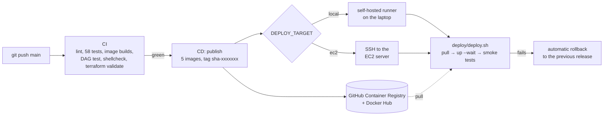

# Deployment and model rollout (Phase 8)

From a `git push` to a running, checked system without manual steps, and from a newly trained model to production
without guesswork. The same images and the same script deploy to the laptop or to an AWS EC2 server.



## 1. Images

| Service | Image | Size |
|---|---|---|
| backend | `ghcr.io/<owner>/rover-backend` | 0.3 GB |
| serving | `ghcr.io/<owner>/rover-serving` (includes the release model) | 0.5 GB |
| mlflow | `ghcr.io/<owner>/rover-mlflow` | 1.3 GB |
| spark (also alert bridge, drift monitor) | `ghcr.io/<owner>/rover-spark` | 2.3 GB |
| airflow (with the training environment) | `ghcr.io/<owner>/rover-airflow` | 4.7 GB |

Tags: `sha-<7 chars>` (exactly one commit, what deployments use), `latest`, and `1.2.3` for a git tag `v1.2.3`.
Each image carries the commit as a label (`org.opencontainers.image.revision`). With the repository secrets
`DOCKERHUB_USERNAME` and `DOCKERHUB_TOKEN` (Docker Hub → Account settings → Personal access tokens) the same images
are also pushed to `docker.io/<user>/rover-<service>`.

## 2. What a deployment does (`deploy/deploy.sh <commit>`)

1. **Checkout** of the commit in the deployment clone: the compose file, Prometheus rules, DAGs and the release model
   must belong to the images that are being started.
2. **Pull** of its images. If a pull fails, nothing has been touched and the running release stays.
3. **`docker compose up -d --wait`**: only containers whose image or settings changed are replaced; Compose waits
   for every health check (backend `/ready`, serving `/ready` = model loaded, MLflow, PostgreSQL, …). Data stays in
   the Docker volumes; the backend and Airflow migrate their databases on start.
4. **Smoke tests** (`deploy/smoke.sh`): readiness of backend, MLflow and serving, **a real prediction** with the
   served model's input shape, and the UIs of the enabled profiles (Prometheus, Grafana, Airflow, Spark).
5. **Registry seed** (mlops profile): a new server's empty registry gets the release model as v1 `@champion`, so
   the first retraining there has a model to beat.

If step 3 or 4 fails, the script deploys the previous release the same way (**automatic rollback**) and exits
with an error, so the CD run is red. `.deploy/current` holds the deployed commit, `.deploy/history` every attempt.

Which parts run is set once in the target's `.env`: `COMPOSE_PROFILES=` (core only), `mlops`, `monitoring,mlops`, ….

## 3. Model rollout

A model goes through four stages before and after it serves anyone:

| Stage | Where | What decides |
|---|---|---|
| **Challenger** | registry alias `@challenger` (retraining, Phase 7) | k-fold CV + hold-out test; the champion is re-scored on the same test clips |
| **Shadow** | the serving API loads `@challenger` next to `@champion` and scores every request with both; only the champion answers | live traffic: agreement rate and alert rate in Grafana (*Model & drift → Model rollout*) |
| **Champion** | `@champion`; the serving API hot-reloads it within `RELOAD_SECONDS` | the promotion gate (automatic in the DAG), or a person via the *Model rollout* workflow |
| **Rollback** | `@champion` moved back to an older version | *Model rollout* workflow → `rollback` + version; serving follows within seconds |

The *Model rollout* workflow (Actions → Model rollout → Run workflow) runs `deploy/model.sh` on the deployment target:
`list`, `promote` (gate), `promote-force` (a person overrides the gate) or `rollback <version>`. After a change it
asks serving to reload and waits until `/v1/models/fight` reports the new version, so a green run means the new model is
actually live. The run log is the audit trail of who changed the production model when.

**A new server and its first model.** The serving image contains `models/release/` (the champion when the image was
built: `python -m mlops.registry release`, committed with the code). While the server's registry has no champion,
serving answers with this model (`"source": "bundled"`) instead of failing its health check; the registry seed
(step 5 above) then makes it the registry's champion and serving switches to it.

## 4. Setting up a target

### Local (the laptop)

1. GitHub → repository → Settings → Actions → Runners → **New self-hosted runner** (Windows), install it, and give it the
   label `rover`. It runs only jobs of this repository.
2. A deployment clone, separate from the development folder:
   ```powershell
   git clone https://github.com/Ahmad450-gcu/ai-surveillance-rover.git C:\rover-deploy
   copy .env C:\rover-deploy\.env
   ```
   and in `C:\rover-deploy\.env`: `IMAGE_PREFIX=ghcr.io/ahmad450-gcu/rover`, `COMPOSE_PROFILES=` as wanted.
3. Settings → Secrets and variables → Actions → **Variables**: `DEPLOY_TARGET=local`, `DEPLOY_DIR=C:/rover-deploy`.

Both folders use the Compose project `rover`, so the deployment takes over the same containers and volumes (the same
database, lake and registry): a development `docker compose up` and a deployment simply replace each other's containers.

### AWS EC2

One server, switched on only when it is needed. Everything goes through `tools/aws.py`:

```powershell
winget install Amazon.AWSCLI
winget install Hashicorp.Terraform        # then open a new terminal
aws login                                 # browser sign-in; short-lived credentials, no access keys on disk
python tools/aws.py check                 # region, Free plan types, limits, dry run: creates nothing
python tools/aws.py prepare               # SSH key + the server's own passwords (once)
python tools/aws.py plan                  # what would be created: creates nothing
python tools/aws.py apply                 # creates it, after asking
python tools/aws.py deploy                # installs the latest published release and smoke-tests it
python tools/aws.py copy-data             # this computer's alerts, users, models and training data -> the server
```

| | Setting (`deploy/aws/variables.tf`) |
|---|---|
| Region | `ap-southeast-2` (Sydney). Accounts of AWS's new sign-up have one fixed region |
| Server | `m7i-flex.large`: 2 vCPU, 8 GB, Free plan eligible; Ubuntu 24.04, 4 GB swap, encrypted 60 GB disk, fixed IP |
| Runs | every profile: `COMPOSE_PROFILES=streaming,monitoring,mlops` |
| Open to the internet | SSH with the key only (no passwords). The dashboard (8080) and Grafana (3000) only for the address `apply` was run from (run it again when that changes) and `app_cidrs` |
| Everything else | SSH tunnel: `python tools/aws.py tunnel` puts each service on the same `localhost` port as the local stack |
| Passwords | generated, different from the laptop's: `deploy/aws/server.env` (git-ignored), listed in `MY_LOGINS.txt` |
| Daily stop | 23:30 (`stop_at`): the server shuts itself down, the data stays. Cancel once: `sudo shutdown -c` on the server |

**Daily use:** `start`, `tunnel`, `status` (containers, memory, credits left), `stop`. The detector keeps running where the
camera is; `run` opens the tunnel and starts it against the server:

```powershell
python tools/aws.py run -- --source pi_clip.mp4 --set streaming.camera_id=pi-cam
```

Frames go to the server's Kafka and alerts to its backend. `backend.upload_media` also sends the photos and clips
(`PUT /api/device/media/…`, device token), because the backend can't see this computer's folder. Use the dashboard at
`http://localhost:8080` while the detector runs: the live view comes from this computer.

**What `copy-data` copies:** the databases `rover` and `mlflow`, the lake without the 12 GB video archive and the DVC
versions, the alert photos, and the training skeletons (about 70 MB). That is all a retraining needs: it
rebuilds the training windows from the skeletons. It replaces the server's data, and asks first. The first `dvc push` on
the server warns about versions that exist only on the laptop; this is expected.

**Automatic deployments:** GitHub → Settings → Variables `DEPLOY_TARGET=ec2`, `EC2_HOST=<ip>`; secret `EC2_SSH_KEY` = the
content of `~/.ssh/rover_aws`. Then every push that passes CI is deployed (the server must be on). GitHub's runners connect
from changing addresses, which is why SSH is open to all addresses (keys only). Stricter: set `ssh_cidrs`
to your address and run a self-hosted runner with the label `rover` on the server (`DEPLOY_TARGET=local`,
`DEPLOY_DIR=/opt/rover`). Moving between the laptop and EC2 only changes these variables: same images, same script.

**A retraining changes committed files on the server** (`dvc.lock`, `reports/`). A deployment keeps them unless the new
commit changes the same files; then they are saved in `.deploy/kept/` first. Airflow runs with the uid that owns the
folder (`AIRFLOW_UID=1000`).

**Cost (estimate, Sydney):** USD 0.12 per hour while on, plus about USD 9 a month for the disk and the fixed IP even
while off. `destroy` removes everything, including the data.

**Memory:** the 13 containers without Airflow measured 1.9 GB on the laptop, Airflow may use up to 3.3 GB, so all
profiles should fit in 8 GB. With 2 vCPUs, streaming is expected to slow down while a model trains. Not measured on EC2 yet.

## 5. Rolling back

| What | How |
|---|---|
| A deployment that fails its checks | automatic (previous release redeployed by `deploy.sh`) |
| A deployment that passed but misbehaves | Actions → CD → Run workflow with `ref` = the previous commit |
| A model | Actions → Model rollout → `rollback` + version (or `python -m mlops.registry set-alias champion <v>`) |

## 6. Results

Measured on the laptop (Windows 11, 7.4 GB RAM, Docker VM 3.6 GB), 22 Nov 2026. The deployment clone was a separate
folder with `COMPOSE_PROFILES=` (core) and `IMAGE_PREFIX=ghcr.io/ahmad450-gcu/rover`.

**Publishing.** Every push ran CI (4 jobs) and then CD: the 5 images were built and pushed in parallel to
`ghcr.io/ahmad450-gcu/rover-*` with `sha-…` and `latest` tags. The packages are public, so a server pulls them without
logging in. Docker Hub was skipped because its secrets are not set yet.

| Test | What happened | Time |
|---|---|---|
| First deployment (`fa5acec`) | pull (core images ≈ 2 GB) → `up --wait` → smoke tests: backend, MLflow, serving, prediction by registry v4: **deployed** | 7 min 17 s (≈ 6 min pulling) |
| Forced failure (`3e37bb5` + a check that can't pass) | `FAILED at smoke tests` → **rolled back to `fa5acec`** (images cached: 1 min) | 12 min |
| Model rollback v4 → v1 → v4 (`deploy/model.sh rollback`) | alias moved, serving reloaded, script confirmed `serving: v1 is live`, then `v4 is live` | 22 s, 19 s |
| Shadow scoring (400 real windows from the test set, champion v4, shadow v5) | every answer from v4; v5 scored all 400; decisions agreed on **82 %** of windows; windows above threshold 128 (v4) vs 129 (v5) | – |

The 82 % agreement is the reason for the shadow stage: v5 and v4 have almost the same test F1 and raise almost the same
number of alerts, yet they disagree on one window in five. A promotion that looks neutral by the numbers still changes
*which* situations raise an alarm, and the shadow metrics show this on real traffic before anyone promotes.

**Problems these tests found, now fixed:**

- The rollback re-ran the failing check that was meant for the new release, so a successful rollback was reported as
  failed. Extra checks (`SMOKE_EXTRA_URLS`) now apply only to the new release.
- `deploy.sh` checks out other commits while it runs, and bash reads a script while executing it. A commit that
  changes `deploy.sh` could have made the running deployment execute the wrong lines. The script now runs inside a
  function, so bash reads all of it before it starts.
- `model.sh` read the version from MLflow's multi-line JSON incorrectly. Serving had already switched, but the script
  waited 2 minutes and then reported a failure.
- On the overloaded laptop (Docker swap almost full), the backend sometimes answered on the host port only 1–3 minutes
  after Docker reported it healthy. The smoke tests now wait up to about 6 minutes per service. A plain restart
  answers within 6 s, so this is memory pressure, not the deployment.

**After these fixes**, the commit that contains them (`259dfd3`) went through CI and CD and was deployed the way the
CD job does it (fetch, checkout, `deploy/deploy.sh 259dfd3`), replacing `fa5acec`: pull 3 min 44 s, `up --wait`
56 s (backend, MLflow and serving recreated; PostgreSQL and MinIO untouched), every smoke test `ok` on the first
try, prediction by registry v4: **deployed in 4 min 46 s**.

## 7. Tests

- `tests/test_serving.py`: the bundled release model serves until the registry has a champion and is never used
  again after that; the shadow model scores every request but never answers, and its metrics count each window;
  a broken challenger doesn't affect the champion.
- `tests/test_models.py`: `seed` registers the release model once, with the artifacts serving reads and the metrics
  the promotion gate needs.
- `tests/test_aws.py`: the server's passwords are its own, every required setting is there, the tunnel uses the
  published ports, cloud-init is valid. `tests/test_backend.py`: photo upload (token, types, size, no path escape).
- CI: `shellcheck` on every deployment script, `terraform fmt` + `validate` on the EC2 configuration.
- Manual test cases TC-78 … TC-81 in [TESTING.md](TESTING.md).
