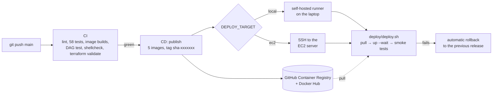

# Deployment and model rollout (Phase 8)

From a `git push` to a running, checked system without manual steps, and from a newly trained model to production
without guesswork. The same images and the same script deploy to the laptop or to an AWS EC2 server.



## 1. Images

| Service | Image | Size |
|---|---|---|
| backend | `ghcr.io/<owner>/rover-backend` | 0.3 GB |
| serving | `ghcr.io/<owner>/rover-serving` (includes the release model) | 0.5 GB |
| mlflow | `ghcr.io/<owner>/rover-mlflow` | 1.3 GB |
| spark (also alert bridge, drift monitor) | `ghcr.io/<owner>/rover-spark` | 2.3 GB |
| airflow (with the training environment) | `ghcr.io/<owner>/rover-airflow` | 4.7 GB |

Tags: `sha-<7 chars>` (exactly one commit, what deployments use), `latest`, and `1.2.3` for a git tag `v1.2.3`.
Each image carries the commit as a label (`org.opencontainers.image.revision`). With the repository secrets
`DOCKERHUB_USERNAME` and `DOCKERHUB_TOKEN` (Docker Hub → Account settings → Personal access tokens) the same images
are also pushed to `docker.io/<user>/rover-<service>`.

## 2. What a deployment does (`deploy/deploy.sh <commit>`)

1. **Checkout** of the commit in the deployment clone: the compose file, Prometheus rules, DAGs and the release model
   must belong to the images that are being started.
2. **Pull** of its images. If a pull fails, nothing has been touched and the running release stays.
3. **`docker compose up -d --wait`**: only containers whose image or settings changed are replaced; Compose waits
   for every health check (backend `/ready`, serving `/ready` = model loaded, MLflow, PostgreSQL, …). Data stays in
   the Docker volumes; the backend and Airflow migrate their databases on start.
4. **Smoke tests** (`deploy/smoke.sh`): readiness of backend, MLflow and serving, **a real prediction** with the
   served model's input shape, and the UIs of the enabled profiles (Prometheus, Grafana, Airflow, Spark).
5. **Registry seed** (mlops profile): a new server's empty registry gets the release model as v1 `@champion`, so
   the first retraining there has a model to beat.

If step 3 or 4 fails, the script deploys the previous release the same way (**automatic rollback**) and exits
with an error, so the CD run is red. `.deploy/current` holds the deployed commit, `.deploy/history` every attempt.

Which parts run is set once in the target's `.env`: `COMPOSE_PROFILES=` (core only), `mlops`, `monitoring,mlops`, ….

## 3. Model rollout

A model goes through four stages before and after it serves anyone:

| Stage | Where | What decides |
|---|---|---|
| **Challenger** | registry alias `@challenger` (retraining, Phase 7) | k-fold CV + hold-out test; the champion is re-scored on the same test clips |
| **Shadow** | the serving API loads `@challenger` next to `@champion` and scores every request with both; only the champion answers | live traffic: agreement rate and alert rate in Grafana (*Model & drift → Model rollout*) |
| **Champion** | `@champion`; the serving API hot-reloads it within `RELOAD_SECONDS` | the promotion gate (automatic in the DAG), or a person via the *Model rollout* workflow |
| **Rollback** | `@champion` moved back to an older version | *Model rollout* workflow → `rollback` + version; serving follows within seconds |

The *Model rollout* workflow (Actions → Model rollout → Run workflow) runs `deploy/model.sh` on the deployment target:
`list`, `promote` (gate), `promote-force` (a person overrides the gate) or `rollback <version>`. After a change it
asks serving to reload and waits until `/v1/models/fight` reports the new version, so a green run means the new model is
actually live. The run log is the audit trail of who changed the production model when.

**A new server and its first model.** The serving image contains `models/release/` (the champion when the image was
built: `python -m mlops.registry release`, committed with the code). While the server's registry has no champion,
serving answers with this model (`"source": "bundled"`) instead of failing its health check; the registry seed
(step 5 above) then makes it the registry's champion and serving switches to it.

## 4. Setting up a target

### Local (the laptop)

1. GitHub → repository → Settings → Actions → Runners → **New self-hosted runner** (Windows), install it, and give it the
   label `rover`. It runs only jobs of this repository.
2. A deployment clone, separate from the development folder:
   ```powershell
   git clone https://github.com/Ahmad450-gcu/ai-surveillance-rover.git C:\rover-deploy
   copy .env C:\rover-deploy\.env
   ```
   and in `C:\rover-deploy\.env`: `IMAGE_PREFIX=ghcr.io/ahmad450-gcu/rover`, `COMPOSE_PROFILES=` as wanted.
3. Settings → Secrets and variables → Actions → **Variables**: `DEPLOY_TARGET=local`, `DEPLOY_DIR=C:/rover-deploy`.

Both folders use the Compose project `rover`, so the deployment takes over the same containers and volumes (the same
database, lake and registry): a development `docker compose up` and a deployment simply replace each other's containers.

### AWS EC2

```powershell
cd deploy/aws
copy terraform.tfvars.example terraform.tfvars      # region, key pair, your IP
terraform init
terraform apply                                     # prints the address and the next steps
```

Terraform creates the server (Ubuntu 24.04, `t3.large` with 8 GB; `t3.xlarge` for every profile at once), an encrypted
60 GB disk, a fixed IP and a security group that opens SSH and the dashboard (8080) only to the addresses in
`terraform.tfvars`. cloud-init installs Docker from Ubuntu's repository, adds swap and clones the project to `/opt/rover`.
Then:

1. `ssh ubuntu@<ip>`, `cd /opt/rover && cp .env.example .env`, fill in the passwords, `IMAGE_PREFIX`, `COMPOSE_PROFILES`.
2. Variables: `DEPLOY_TARGET=ec2`, `EC2_HOST=<ip>`; secret `EC2_SSH_KEY` = the key pair's private key.
3. Actions → CD → Run workflow (or the next push to main).

GitHub's hosted runners connect from changing addresses, so SSH must either be open to them (`ssh_cidrs =
["0.0.0.0/0"]`; the server accepts keys only, no passwords) or, more strictly, the server runs its own
self-hosted runner with the label `rover` and the target is `local` with `DEPLOY_DIR=/opt/rover`, so no inbound SSH
from GitHub is needed at all. Moving between the laptop and EC2 only changes these variables: same images, same script.

**Cost:** an on-demand `t3.large` costs roughly USD 0.08–0.10 per hour depending on the region, plus the disk, so
about USD 2–3 per day of demo. `terraform destroy` removes everything when it is no longer needed.

## 5. Rolling back

| What | How |
|---|---|
| A deployment that fails its checks | automatic (previous release redeployed by `deploy.sh`) |
| A deployment that passed but misbehaves | Actions → CD → Run workflow with `ref` = the previous commit |
| A model | Actions → Model rollout → `rollback` + version (or `python -m mlops.registry set-alias champion <v>`) |

## 6. Results

RESULTS_PLACEHOLDER

## 7. Tests

- `tests/test_serving.py`: the bundled release model serves until the registry has a champion and is never used
  again after that; the shadow model scores every request but never answers, and its metrics count each window;
  a broken challenger doesn't affect the champion.
- `tests/test_models.py`: `seed` registers the release model once, with the artifacts serving reads and the metrics
  the promotion gate needs.
- CI: `shellcheck` on every deployment script, `terraform fmt` + `validate` on the EC2 configuration.
- Manual test cases TC-78 … TC-81 in [TESTING.md](TESTING.md).
