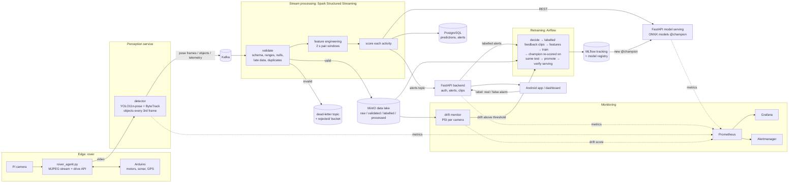

# MLOps Architecture – Production Pipeline

This document describes the end-to-end, production-grade MLOps pipeline of the AI Surveillance Rover: how data flows from the rover's camera to an alert on the phone, how that data is validated, stored and monitored, and how models are retrained, registered and redeployed automatically when the data drifts.

It follows three reference architectures:

1. **Real-time ML system:** streaming → validation → prediction → storage → retraining → deployment
2. **Development pipeline:** dataset → preprocessing → split → train → validate → test → metrics → persistence → Docker
3. **Complete ML life cycle:** development → deployment → real-time production → retraining → deploy new model

---

## 1. System overview



## 2. Components and how they map to the reference architectures

| Reference box | Our component | Port | Status |
|---|---|---|---|
| Data sources (IoT / sensors) | Rover camera + telemetry; `run.py` turns video into structured records | – | ✅ |
| Streaming ingestion | **Apache Kafka** (KRaft, single broker, idempotent producers). Topics: `rover.pose-frames` (key = camera, 3 partitions), `rover.pose-frames.dlq`, `rover.alerts` ([STREAMING.md](STREAMING.md)) | 9094 (host) | ✅ |
| Stream processing & data quality | **Spark Structured Streaming** (`streaming/spark_job.py`): 11 validation rules (schema, types, missing fields, shapes, ranges, late / future events) → dead-letter topic + `rejected/`; valid frames → Parquet in `validated/`; stateful fight scoring per camera session (`applyInPandasWithState`, same code as the edge) via the serving API → PostgreSQL `predictions` + `rover.alerts`; alert bridge → backend | 4040 (UI) | ✅ |
| Invalid / rejected data | Dead-letter topic `rover.pose-frames.dlq` + `rejected/` bucket with the rejection reason | – | ✅ |
| Data lake | **MinIO** (S3-compatible). Buckets `raw`, `validated`, `rejected`, `labelled`, `processed` (partitioned by rover and date, Parquet), plus `datasets`, `mlflow` (artifact store) and `dvc` (DVC remote). Versioning on curated buckets; raw footage expires after 30 days, rejected records after 14 | 9000 / 9001 | ✅ buckets (Phase 1); data in Phase 2 |
| Operational store | **PostgreSQL**: alerts, predictions, telemetry, users; metadata for MLflow and Airflow | 5432 | ✅ |
| Model serving | **FastAPI** inference service (`serving/`), ONNX Runtime, loads `@champion` of each activity from the registry over MLflow's REST API, hot-reloads on promotion/rollback, Prometheus `/metrics` ([SERVING.md](SERVING.md)) | 8000 | ✅ |
| App backend | FastAPI backend (auth, alerts, clips, rover commands), SQLAlchemy on PostgreSQL, `/health` + `/ready` probes | 8080 | ✅ |
| Monitoring & alerting | **Prometheus** (8 targets, 10 alert rules), **Grafana** (2 dashboards generated as code, Prometheus + PostgreSQL), **Alertmanager** → webhook; kafka-exporter; metrics in serving, backend and the Spark job ([MONITORING.md](MONITORING.md)) | 9090 / 3000 / 9093 | ✅ |
| Data drift | **drift monitor** (`monitoring/`): per-camera PSI of 5 pose features vs the training reference (DVC stage `drift_reference`), prediction drift (PSI of probabilities vs the previous 7 days), concept drift (false-alarm rate of labelled alerts); drift alerts create **retraining requests** | 9200 | ✅ |
| Retraining pipeline | **Apache Airflow** (LocalExecutor) DAG `fight_retraining`: labelled alerts → feedback clips → DVC stages → challenger → promotion gate → serving hot reload. Triggers: drift (monitor → Airflow REST API), daily check (pending request, ≥ 5 new labels, model older than 7 days), manual ([RETRAINING.md](RETRAINING.md)) | 8081* | ✅ |
| Experiment tracking & registry | **MLflow** server (PostgreSQL backend, MinIO artifacts). Registered model `fight-detector` (ONNX); aliases `@challenger` → `@champion` with a promotion gate (`mlops/registry.py`) | 5000 | ✅ |
| Data & model versioning | **DVC** pipeline (`dvc.yaml`: ingest → extract_pose → validate → feedback → features → train_fight → drift_reference), remote = MinIO bucket `dvc` | – | ✅ |
| Model training & tuning | PyTorch models (GRU, TCN, ST-GCN in `rover_ai/nets.py`), k-fold CV, **Optuna** search with pruning (`training/tune_fight.py`), ONNX export checked by ONNX Runtime | – | ✅ |
| Containerisation | Dockerfile per service (`docker/`), one `docker-compose.yml` with health checks, memory limits and profiles | – | ✅ |
| CI/CD | **GitHub Actions**: lint + tests (SQLite and PostgreSQL) + compose validation + image builds on every push/PR → publish images → deploy | – | 🟡 CI done; CD in Phase 8 |

\* Airflow's web UI is on host port 8081 because the backend already uses 8080.

## 3. Data layer and data quality

- **Ingestion:** the source dataset is downloaded once, verified against its published SHA-256 and stored immutably in `s3://datasets/`. A manifest in git records which version was used.
- **Zones:** `raw` (as produced) → `validated` (passed the checks) or `rejected` (with the reason) → `processed` (training splits). Code in `mlops/lake.py`.
- **Data contract** (`mlops/validation.py`): clip-level checks (schema, shapes, finite values, value ranges, box geometry, duplicates, minimum length) and dataset-level checks (reject rate, minimum size, class balance, train/test leakage). A failing blocking check stops the pipeline.
- **Reference profile:** `reports/data_profile.json` stores binned distributions of the validated data (people per frame, keypoint and detection confidence, person size, clip length), the baseline for drift detection.

## 4. Development pipeline (training)

Every model is produced by a reproducible DVC pipeline, tracked in MLflow:

```
ingest → extract_pose → validate → feedback → features → train_fight (k-fold CV → alert rule, final fit, hold-out test)
      → export ONNX (parity check) → MLflow run + registry version @challenger
      → promote (gate vs @champion) → registry pull → deployed model (models/fight_model.onnx)
tuning (Optuna, CV on the train split only) feeds the best settings back into params.yaml
```

- **Feature store (offline):** the `features` stage turns validated clips into model-ready windows once (`s3://processed/fight/…`), so every experiment, architecture and tuning trial reuses identical inputs.
- **Reproducibility:** each MLflow run and registry version is tagged with its git commit, the dataset SHA-256 and the DVC hash of the feature windows, and logs all parameters (`params.yaml`).
- **Metrics:** accuracy, precision, recall, F1, ROC-AUC and confusion matrix on the 400 hold-out clips, scored exactly like live detection, next to the hand-tuned rules on the same clips.
- **Promotion gate:** a new version becomes `@champion` only if its test F1 beats the champion by ≥ 0.01 without losing more than 0.02 ROC AUC (`params.yaml` → `registry`). The decision is stored as a version tag and in `reports/promotion.json`; rollback is moving the alias back.
- **Model tests** (`tests/test_models.py`): every architecture's output shape, PyTorch ↔ ONNX equality, augmentation correctness, the live alert rule, metric maths and the promotion gate.

## 5. Real-time production flow

1. The rover streams video to the perception service (`run.py`: YOLO pose + tracking), which publishes per-frame pose and object records to Kafka.
2. Spark validates each record. Invalid records go to the dead-letter topic. Valid ones are written to the lake and turned into 2-second windows.
3. Each window is scored by every registered activity (ML models through the serving API; rule-based activities inline).
4. Predictions go to PostgreSQL. Alerts go to the `rover.alerts` topic, from which the alert bridge stores them in the backend (dashboard and app).
5. **Graceful degradation:** if the streaming stack is unavailable, the detector falls back to in-process inference so the rover keeps protecting the area.

## 6. Monitoring, drift and retraining (the feedback loop)

- **System health:** latency, throughput, errors, Kafka consumer lag, detector FPS.
- **Model health:** prediction confidence distribution, alert rate per activity, false-alarm rate from user labels.
- **Data drift:** the drift monitor compares each camera's recent pose features (keypoint confidence, visible joints, body size, people per frame, pair distance) with the training reference (PSI). Drift fires an Alertmanager alert, which creates a retraining request and starts the Airflow retraining DAG.
- **Human in the loop:** labels from the app/dashboard (real / false alarm) on stream alerts become labelled clips: each alert points at its frames in the lake (`stream://camera/session/frame`), so "false alarm" turns exactly the frames that fooled the model into NonFight training data (`labelled/` zone, DVC stage `feedback`).
- **Retraining:** Airflow rebuilds the feedback clips and features, retrains, re-scores the current champion on the challenger's test clips and promotes only if the challenger is clearly better. Promotion moves `@champion`; the serving API reloads it within a minute and the DAG verifies that it does. Otherwise the champion stays ([RETRAINING.md](RETRAINING.md)).

## 7. Adding a new activity model

All activities are declared in one place (`activities.yaml`, Phase 9): name, type (`rule` or `model`), MLflow model name, input window and threshold. From that entry the pipeline creates the training stage, the Airflow retraining DAG, the `/predict/<activity>` endpoint and the Grafana panels. Today *fighting* is a trained model; *loitering*, *unauthorised access* and *theft* are rules that use the same interface, so each can be replaced by a trained model later without changing the rest of the pipeline.

## 8. Deployment targets

Everything runs in Docker Compose, configured only through environment variables (`.env`, see `.env.example`; any `config.yaml` value can be overridden as `ROVER__<SECTION>__<KEY>`). The same images and compose file run:

- **Locally** (default): one laptop runs the whole stack; GitHub Actions deploys through a self-hosted runner.
- **On a cloud VM** (e.g. AWS EC2): install Docker, copy `.env`, `docker compose pull && docker compose up -d`. Switching only changes host names in `.env`.

Compose profiles keep memory use manageable (`core`, `streaming`, `mlops`, `monitoring`), so an 8 GB machine can run the parts it needs and a 16 GB machine runs the full stack.

## 9. Implementation phases

| Phase | Content | Status |
|---|---|---|
| 0 | Repo setup: env-based config, lint, tests, CI | ✅ |
| 1 | Docker foundation: PostgreSQL, MinIO, MLflow; backend on PostgreSQL | ✅ |
| 2 | Data layer: lake buckets, DVC remote on MinIO, dataset versioning, data validation | ✅ |
| 3 | Training pipeline: features stage, 3 architectures, augmentation, Optuna tuning, MLflow registry (champion/challenger), ONNX export, model tests | ✅ |
| 4 | Model serving API: FastAPI + ONNX Runtime container, registry `@champion` with hot reload, Prometheus metrics, remote model client in the detector | ✅ |
| 5 | Streaming: Kafka + Spark Structured Streaming, validation + dead-letter queue, lake sink, stateful scoring via the serving API, predictions table, alert bridge, edge fallback | ✅ |
| 6 | Monitoring: Prometheus, Grafana, Alertmanager, kafka-exporter, metrics in every service, drift monitor (data / prediction / concept drift), drift → retraining requests | ✅ |
| 7 | Automated retraining with Airflow, feedback labels, champion/challenger | ✅ |
| 8 | CD: image publishing, deployment, model rollout | ⬜ |
| 9 | Activity plugin framework, final docs and demo | ⬜ |
