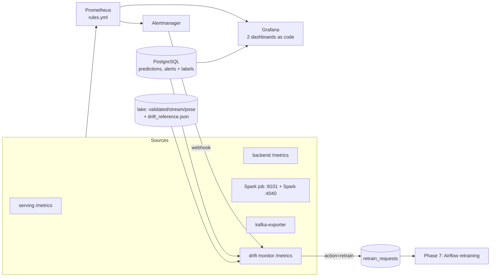

# Monitoring, drift detection and alerting

A model that was good on the test set can quietly get worse in production. The camera may be darker, mounted further away or pointed at other scenes, or behaviour may change. Phase 6 makes that visible and acts on it:

- **System health:** every service exports Prometheus metrics. Grafana shows them, and Prometheus alert rules fire when something breaks.
- **Data drift:** the frames the stream sees are compared with the **training data** (PSI per feature, per camera).
- **Prediction drift:** the model's outputs are compared with its own recent past.
- **Concept drift:** people label alerts as real or false alarm in the app, and the false-alarm rate is tracked.
- **Closing the loop:** a drift alert creates a **retraining request**. Phase 7's Airflow pipeline picks it up, retrains, and the promotion gate decides.



## Services (`docker compose --profile streaming --profile monitoring up -d`)

| Service | Port | What it does |
|---|---|---|
| **Prometheus** | 9090 | scrapes 8 targets every 15 s, keeps 15 days, evaluates the alert rules (`docker/prometheus/`) |
| **Alertmanager** | 9093 | groups alerts and sends them to the drift monitor's webhook (`docker/alertmanager/alertmanager.yml`); e-mail or Slack are one more receiver |
| **Grafana** | 3000 | dashboards *Rover · System health* and *Rover · Model & drift*, generated from `docker/grafana/build_dashboards.py`; data sources Prometheus and PostgreSQL; log in with `GRAFANA_ADMIN_PASSWORD` from `.env` |
| **kafka-exporter** | – | topic offsets (messages per second) and consumer-group lag |
| **drift-monitor** | 9200 | drift checks every 2 min (`/metrics`, `/report`), Alertmanager webhook (`/alertmanager`) |

The metric endpoints added in this phase:

| Source | Metrics |
|---|---|
| serving (Phase 4) | requests, latency, probability histogram, windows above the threshold, model version, hot reloads |
| backend | `rover_alerts_received_total{type,source}` (edge or stream), `rover_alert_labels_total{label}`, detector FPS / people / status age, HTTP requests and latency |
| Spark job | `rover_stream_frames_total{result}`, `rover_stream_rejected_total{reason}`, judgements, alerts, batch duration, **event lag** (camera → scored); Spark's own streaming metrics on `:4040/metrics/prometheus/` |
| Kafka | `kafka_topic_partition_current_offset`, `kafka_consumergroup_lag_sum` |
| drift monitor | `rover_drift_psi{camera,feature}`, `rover_drift_detected{camera}`, `rover_prediction_psi`, `rover_false_alarm_rate`, `rover_retrain_requests_total` |

## Data drift

**Features.** These describe what the camera sees, so they explain *why* a model might get worse (`monitoring/drift.py`):

| Feature | Changes when |
|---|---|
| `kp_conf`: mean keypoint confidence per person | darker scenes, blur, a dirty lens, occlusion |
| `visible_joints`: share of the 17 joints detected | the same, and people cut off by the frame |
| `body_size`: body width / frame height | camera moved closer or further, another lens or resolution |
| `people`: tracked people per frame | busier or emptier scenes |
| `pair_distance`: closest pair, in body widths | how close people stand |

**Reference** is the DVC stage `drift_reference` (`monitoring/reference.py`). It builds the distribution of each feature from the **training split**: 800 clips, 51k people, 40k frames. The result is stored in `reports/drift_reference.json` and `s3://processed/monitoring/`. It is rebuilt whenever the training data changes, so a model and the reference of its data always belong together.

**PSI (population stability index)** is computed with the reference deciles as bins: PSI = Σ (live% − ref%) · ln(live% / ref%).
- below 0.1: stable;
- 0.1–0.2: moderate shift;
- above 0.2: drift.

The check runs **per camera**, over the frames the stream archived in the lake during the last 30 minutes. A camera is judged only with at least **1000 frames** (about 2 minutes of video) and 200 values per feature. Otherwise it reads "insufficient data", because a few seconds of one unusual scene are not a camera that drifted. One camera going dark is caught even when the others are fine, and the alert names the camera.

**Rover footage will drift from day one, and that's correct.** The reference is RWF-2000 CCTV; the rover's camera is low and close. The monitor will report that difference until labelled rover clips are part of the training data (`features.extra_data`, see `TRAINING.md` section 8). Then the `drift_reference` stage rebuilds the reference from that data too.

## Prediction drift and concept drift

- **Prediction drift:** the PSI of the fight probabilities in the last window against the 7 days before it (PostgreSQL `predictions`). The model's output distribution changing is often the first visible sign, and needs no labels.
- **Concept drift:** the share of labelled alerts marked `false_alarm` in the dashboard or app over 7 days. When people say the model is wrong, it is.

## Alert rules (`docker/prometheus/rules.yml`)

| Alert | When | Action |
|---|---|---|
| ServiceDown | a scrape target is down 1 min | – |
| ServingSlow / ServingErrors | p95 > 100 ms / > 5% errors for 5 min | – |
| StreamDataQuality | > 5% of frame records rejected for 2 min | – |
| StreamLagging | scoring > 30 s behind the cameras | – |
| AlertBridgeBacklog | stream alerts not delivered for 5 min | – |
| **DataDriftDetected** | a camera has a feature with PSI > 0.2 for 2 min | **retrain** |
| **PredictionDrift** | probability PSI > 0.2 for 10 min | **retrain** |
| **FalseAlarmRateHigh** | > 50% false alarms among ≥ 10 labelled alerts | **retrain** |
| DriftCheckStale | the drift check hasn't run for 15 min | – |

Alertmanager sends everything to the drift monitor, which stores each notification in `ops_events`. A firing alert labelled `action=retrain` creates **one** row in `retrain_requests`, and no new one while a request is still pending or running. The Grafana model dashboard shows both tables.

## Demonstrating drift (no camera needed)

```bash
python tools/frames.py from-clips data/validated/pose/rwf2000/val data/streams/val100.jsonl.gz --clips 100
python tools/frames.py replay data/streams/val100.jsonl.gz --speed 0 --camera cam-normal              # stable
python tools/frames.py replay data/streams/val100.jsonl.gz --speed 0 --camera cam-dark --drift dark  # drift
curl http://127.0.0.1:9200/report        # or Grafana → Rover · Model & drift
```

- The **normal** stream is 100 validation clips that training never saw, but from the same population, so it should be stable.
- `--drift dark` multiplies keypoint confidences by 0.55, like night or a dirty lens.
- `--drift far` shrinks everyone to half size, like a camera moved back.

## Measured end to end (full stack on the laptop)

13 containers together use about **1.9 GB** of RAM:
- Prometheus about 50 MB;
- Grafana about 150 MB;
- Alertmanager about 30 MB;
- kafka-exporter about 17 MB;
- drift monitor about 100 MB.

| Check | Result |
|---|---|
| Prometheus targets | 8 / 8 up (serving, backend, stream pipeline, Spark, Kafka, drift monitor, Alertmanager, itself); 10 alert rules loaded; `promtool` and `amtool` validate the configs (also in CI) |
| Grafana | both data sources healthy; every query of both dashboards (40 panels) runs without errors against live data |
| Drift, offline and through Kafka + Spark + lake (identical) | **cam-normal** (100 unseen val clips): every PSI ≤ 0.054, all stable · **cam-dark**: `kp_conf` 7.18 and `visible_joints` 0.61 drift, the other three stable · **far** (offline): only `body_size` drifts (1.80) |
| Drift → retraining | `DataDriftDetected{camera="cam-dark"}` pending → firing → Alertmanager → webhook → `ops_events` + **retraining request #1 (pending)**, 2.7 min after the drift check. A second drift alert while #1 is pending creates no new request |
| Data-quality alert | after the smoke test's 12 invalid records, `StreamDataQuality` fired (> 5% of frames rejected), with the reasons on the dashboard |
| A 5-second clip as its own camera | "insufficient data", not a false drift |

Two bugs were found and fixed while building this:
- **Decile edges.** The reference stored its decile edges rounded but computed its proportions with the unrounded ones. Discrete features such as `visible_joints` (values k/17) then showed PSI 2.7 on unchanged data. A regression test now covers it.
- **Minimum frames.** Without the minimum-frames rule, a short clip of one crowded scene was reported as camera drift.
