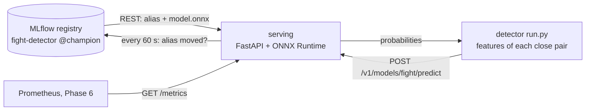

# Model serving API

The trained activity models run behind one small web service, `serving` (FastAPI + ONNX Runtime, port 8000). The service always runs the **`@champion`** version from the MLflow registry. When the champion changes (a promotion, or a rollback), the service loads the new version **without a restart**.



## Why a separate service

- **One model, many clients.** The laptop detector, the Spark stream (Phase 5) and a cloud VM all ask the same service, so they all run the same version.
- **Deployment follows the registry.** `python -m mlops.registry promote` (or a rollback with `set-alias champion <v>`) reaches the running service within `RELOAD_SECONDS`, without copying files or restarting anything. In-flight requests finish on the model they started with; the new model is swapped in atomically.
- **Small and safe image.** ONNX Runtime + FastAPI only: no PyTorch and no MLflow client. The image is about 0.5 GB and uses about 55 MB of RAM. It runs as a non-root user and is healthy only when every model is loaded.
- **Observable.** `/metrics` exposes request counts, latency, the distribution of predicted probabilities (used for prediction drift in Phase 6) and which model version is live.
- **Features stay in one place.** The client computes the features with the same code that training used (`rover_ai/learned.py`). The service checks their shape (`window × n_feat` comes from the model itself), so a model trained on other features cannot be fed the wrong input silently.

## Running it

```bash
docker compose up -d serving             # part of the core stack; waits for MLflow
curl http://127.0.0.1:8000/v1/models     # which version is live, its threshold and test scores
```

Then point the detector at the service instead of the local file:

```bash
python run.py --source tests/videos/fight.avi --set fight.model=http://127.0.0.1:8000/v1/models/fight
# Fight detection: trained TCN http://127.0.0.1:8000/v1/models/fight (fight-detector v4 (served), threshold 0.67)
```

Or set `fight.model` in `config.yaml`, or `ROVER__FIGHT__MODEL=http://...` in `.env`. On Windows use `127.0.0.1` rather than `localhost`: Windows tries IPv6 first, which adds about 2 seconds per request.

The detector also reads the model's settings (window, threshold, alert rule, pairing rules) from the service. When the service reloads another version, the detector picks up that version's settings at its next request. If the service is unreachable at start-up, the detector falls back to the hand-tuned rules. If the service goes down during a run, the detector prints a warning every 10 s and pauses fight judgements until the service is back.

## Endpoints

| Method | Path | What it does |
|---|---|---|
| GET | `/health` | the process is up (liveness) |
| GET | `/ready` | every configured model is loaded (readiness); 503 with the reason otherwise |
| GET | `/v1/models` | all loaded models: registry version, run id, architecture, window, threshold, pairing rules, test F1 / AUC |
| GET | `/v1/models/{activity}` | one model's settings |
| POST | `/v1/models/{activity}/predict` | score windows: `{"instances": [[[...F]...T]...]}` (JSON), or the compact form `{"shape": [B, T, F], "data_b64": "<float32 bytes>"}`; returns `logits`, `probabilities`, `above_threshold`, `model_version` |
| POST | `/admin/reload` | check the registry now; needs `Authorization: Bearer $SERVING_ADMIN_TOKEN` when the token is set |
| GET | `/metrics` | Prometheus metrics |

Bad input is rejected with 422: wrong shape, NaN or infinity, a batch over `MAX_BATCH`, or broken base64. An unknown activity gives 404; a model that is not loaded yet gives 503. Interactive API docs: http://127.0.0.1:8000/docs.

## Settings (`.env`)

| Variable | Default | Meaning |
|---|---|---|
| `SERVING_MODELS` | `fight=fight-detector` | activity = registered model, comma separated. A new activity model (Phase 9) is one more pair. |
| `MODEL_SOURCE` | `registry` | `local` serves `./models/<activity>_model.onnx` + `.json` (no MLflow needed, e.g. an offline demo) |
| `MODEL_ALIAS` | `champion` | e.g. `challenger` for a shadow instance |
| `RELOAD_SECONDS` | `60` | how often to look for a new champion (0 = never) |
| `SERVING_ADMIN_TOKEN` | – | protects `/admin/reload`; set it on a cloud VM |
| `ORT_THREADS` | `2` | ONNX Runtime threads |

## Metrics

| Metric | Use |
|---|---|
| `serving_requests_total{activity,status}` | traffic and error rate |
| `serving_request_seconds` (histogram) | latency (p50 / p95); about 1 ms per request on a laptop CPU |
| `serving_windows_total`, `serving_above_threshold_total` | windows scored, and the share above the threshold |
| `serving_probability` (histogram) | predicted-probability distribution: **prediction drift** (Phase 6) |
| `serving_model_info{activity,version,arch}` | the version that is live (Grafana annotations when it changes) |
| `serving_model_reloads_total` | hot reloads |

## Checked behaviour

- **The same numbers as the local model.** Serving's probabilities equal the local ONNX file's to 1e-5. Run on `fight.avi` through the API, the detector raises the same alert at the same moment (2.9 s, the same two people) as with the local file.
- **Rollback, live.** `python -m mlops.registry set-alias champion 1` was followed by the container serving v1 (GRU) 37 s later, without being touched. Setting the alias back to 4 restored the TCN.
- **Speed.** All close pairs of a frame are scored in one request. A request takes about 4 ms against a natively running server, and about 26 ms through Docker Desktop's port forwarding on Windows (that proxy doesn't exist on Linux or EC2). Both are small next to YOLO's ~100 ms per frame.
- **Tests** (`tests/test_serving.py`):
  - predictions equal ONNX Runtime in both payload forms
  - bad input is rejected
  - the registry champion is hot-reloaded
  - a registry outage keeps the old model
  - the admin token is enforced
  - the detector's client follows a version change
  - the detector survives the service going down
