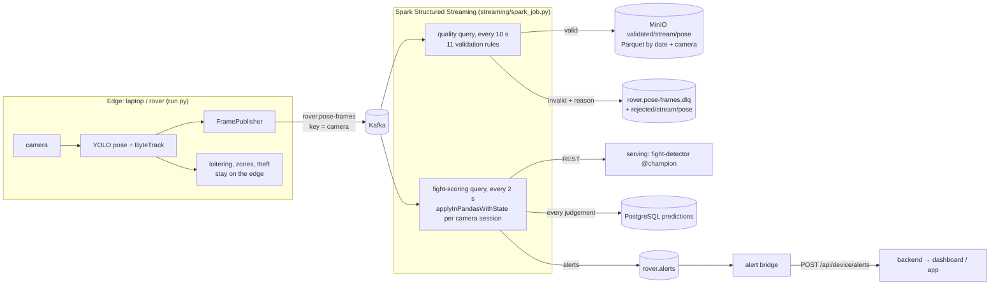

# Streaming pipeline (Kafka + Spark Structured Streaming)

The detector on the laptop or the rover is the **edge**. It runs the camera, YOLO pose and tracking. With streaming on, it sends every frame's tracked skeletons to **Kafka**. A **Spark Structured Streaming** job then does four things with them:
- checks every record;
- archives the good ones in the data lake, and puts the bad ones in a dead-letter queue;
- judges fights with the served `@champion` model;
- writes every judgement to PostgreSQL.

Alerts go to their own Kafka topic. A small **alert bridge** delivers them to the backend, which shows them in the dashboard and the app.



## Why each part is there

| Part | What it gives |
|---|---|
| **Kafka** (KRaft, no ZooKeeper) | A durable buffer between cameras and processing. A slow or restarting Spark job loses nothing; the frames wait in the topic (kept 24 h). Each camera is a message key, so its frames stay in order in one partition. Several cameras spread over the 3 partitions. Topics are created by `kafka-init` with auto-creation off, so a typo can't create a topic silently. |
| **Idempotent producer** | `enable.idempotence` + `acks=all`: when the network makes the detector retry, the broker still stores each frame once. |
| **Validation + dead-letter queue** | Bad data never reaches the model or the lake's training data, and nothing is silently dropped either. Each rejected record goes to `rover.pose-frames.dlq` and `s3://rejected/` with its reason, for inspection. |
| **Lake sink** | Every valid frame is archived as Parquet (`s3://validated/stream/pose/date=…/camera_id=…/`). This is the data for retraining (Phase 7) and drift detection (Phase 6). |
| **Stateful scoring** (every 2 s) | A fight is a pattern over 2 seconds, not a single frame. `applyInPandasWithState` keeps each camera session's last 3 s of tracks and alert history in Spark's checkpointed state store. |
| **Model through the serving API** | Spark doesn't load models. It always asks the current `@champion` (Phase 4), so a promotion or rollback reaches the stream without restarting Spark. |
| **predictions table** | Every judgement (probability, threshold, model version, event time) is stored. Phase 6 builds model monitoring and prediction-drift dashboards on it. |
| **Alert bridge** | Decouples alert delivery from processing. An alert's Kafka offset is committed only after the backend has stored it, so if the backend is down nothing is lost; the bridge retries. |

## Same results as the edge

The stream does not reimplement detection. `streaming/scoring.py` feeds the frame records into the **same classes the edge uses**: `PeopleState` builds the tracks, and `LearnedFightDetector` applies the pairing rules, the 2 s windows, the model and the "N judgements in a row" alert rule. It also applies the edge's two alert cooldowns (the same pair, and any fight from that camera), but measured in stream time. As a result:
- The recorded fight clip gives the **same alert as the edge**: 2.9 s, IDs 5 and 9, 67%.
- Splitting the frames into random micro-batches, adding repeated frames and passing the state through JSON between batches gives **identical** judgements to one sequential pass (`tests/test_streaming.py`).
- Results don't depend on how fast Spark runs, because time comes from the frames, not from the wall clock. The edge's cooldowns now use the detector's clock too (video time for files, wall time for live cameras), so a video file gives the same alerts on every run.

## Validation rules

Checked in Spark SQL (`RULES` in `streaming/spark_job.py`); the first rule a record breaks is its reason:

| Reason | Rejected when |
|---|---|
| `malformed` | not JSON, or a field of the wrong type |
| `unsupported_schema` | `schema` ≠ 1 |
| `missing_camera` | no `camera_id` or `session` |
| `missing_time` | no `frame`, `t` or `ts` |
| `bad_frame_size` | width or height missing or ≤ 0 |
| `missing_people` | no `people` list (an empty list is fine) |
| `bad_person_shape` | a person without an id, without 4 box values, or without 17 keypoints of 3 values |
| `bad_box` | box with x2 ≤ x1 or y2 ≤ y1, or confidence outside 0–1 |
| `keypoint_out_of_range` | keypoint more than 10% outside the frame, or keypoint confidence outside 0–1 |
| `too_late` | event time older than `STREAM_MAX_LAG_SECONDS` (default 300) |
| `clock_skew` | event time more than 60 s in the future |

## Running it

```bash
docker compose --profile streaming up -d --build     # adds kafka, kafka-init, spark, alert-bridge to the core stack
docker compose ps                                     # all "healthy" (kafka-init: exited 0)
python tools/stream_smoke_test.py                     # end-to-end check, see below
```

**Live, from the detector:** set `streaming.enabled: true` in `config.yaml` (or `ROVER__STREAMING__ENABLED=true`):

```bash
python run.py --source tests/videos/fight.avi --set streaming.enabled=true
# Streaming: frames -> Kafka 127.0.0.1:9094 topic rover.pose-frames as camera 'rover-1', session 3f2a...; the stream scores fights
```

**Without a camera or YOLO:** `tools/frames.py` records a video's skeletons once and replays them into Kafka at real speed (or faster), as a new camera session each time. This is handy for demos and load tests:

```bash
python tools/frames.py capture tests/videos/fight.avi data/streams/fight.jsonl.gz
python tools/frames.py replay data/streams/fight.jsonl.gz --camera demo-1
```

**Where to look:**
- **Spark UI:** http://localhost:4040, *Structured Streaming* tab. It shows input rate, processing rate and batch duration for the `quality` and `fight-scoring` queries.
- **Predictions:** `docker compose exec postgres psql -U rover -c "select camera_id, frame, person_a, person_b, probability, alert from predictions order by id desc limit 10"`
- **Dead-letter queue:** `docker compose exec kafka /opt/kafka/bin/kafka-console-consumer.sh --bootstrap-server localhost:9092 --topic rover.pose-frames.dlq --from-beginning`
- **Lake:** MinIO console http://localhost:9001, buckets `validated` and `rejected`, folder `stream/pose/`.
- **Alerts:** the dashboard (http://localhost:8080). Stream alerts end in `[stream]`.

## Edge behaviour and graceful degradation

| Situation | What the edge does |
|---|---|
| `streaming.enabled: false` (default) | Everything runs on the edge, as before |
| Streaming on, Kafka reachable | Publishes every frame. Loitering, zones and theft stay on the edge (they depend on the operator's zones and the live picture); **fights are judged by the stream** (`fight_on_server: true`) |
| Kafka unreachable (at start or later) | Prints a warning and **judges fights itself** until Kafka answers again. Frames that can't be delivered within 10 s are dropped, because old frames are useless for live detection. |
| Serving API down | Spark keeps the frames as track context and judges nothing until it is back; the edge is unaffected |
| Backend down | The alert bridge retries (backing off up to 30 s) and doesn't commit the alert, so it is delivered when the backend returns |
| Spark restarted | Continues from its checkpoint (Kafka offsets + scoring state in the `sparkcheckpoints` volume) |

**Delivery guarantees.** Every sink is idempotent:
- lake files are named by micro-batch id;
- predictions are unique per camera, session, frame and pair;
- every alert has an id, and the bridge drops repeats.

So a micro-batch replayed after a crash doesn't create duplicates. This is effectively exactly-once, built on Spark's at-least-once `foreachBatch`.

## Measured on the laptop

| What | Result |
|---|---|
| End-to-end check (`tools/stream_smoke_test.py`) | 4 / 4 PASS: all 12 invalid test records (11 rules) in the dead-letter queue with the right reason; 463 judgements; 1 alert; stored by the backend |
| Fight clip replayed at real speed, 5 runs | every run: **463 judgements and exactly 1 alert** (2.9 s, IDs 5 and 9, 67%), the same as the edge |
| Latency: fight moment in the video → alert stored in the backend | **4.5–5.4 s** (2 s trigger + scoring + Kafka + bridge) |
| Live edge run (`run.py --set streaming.enabled=true` on fight.avi) | 150 / 150 frames delivered; alert `FIGHT: ID 5 and ID 9 (67%) [stream]` in the backend |
| Kafka stopped at start, started during the run | edge raised the alert itself at 2.9 s, then printed "Kafka reachable again" and handed fights back to the stream |
| Backend stopped while an alert was raised | the bridge retried (2, 4, 8 s …) and stored the alert once the backend was back: nothing lost, no duplicate |
| Spark restarted | continued from its checkpoint |

Two optimisations came out of these measurements:
- **Vectorised body centre and width.** These are computed for all 20 frames of a window at once instead of frame by frame (`_person_frames`). Results are equal to 0.00002 px, and it is about 6× faster. This also speeds up the edge and feature building.
- **Persisting the micro-batch in `foreachBatch`.** Without it, Spark ran the stateful scoring twice per batch: once for the predictions, once for the alerts.

Together they cut the latency of a burst from 54 s to 17 s, and at real speed from 8 s to about 5 s.

## Resources

On the laptop (Docker Desktop with 3.8 GB), the streaming profile adds about:
- Kafka: 380–440 MB, 256 MB heap;
- Spark in local mode with 2 cores: about 1.1 GB;
- the alert bridge: about 15–30 MB.

The core stack and the streaming profile together fit in the 3.8 GB.

The same job runs unchanged on a Spark cluster (`spark-submit --master spark://…` or `k8s://…`). Kafka and Spark scale out by adding partitions and executors. On a cloud VM, set `KAFKA_EXTERNAL_HOST` in `.env` to the VM's address so the rover can reach Kafka.
