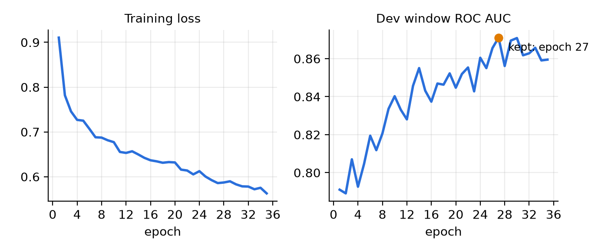
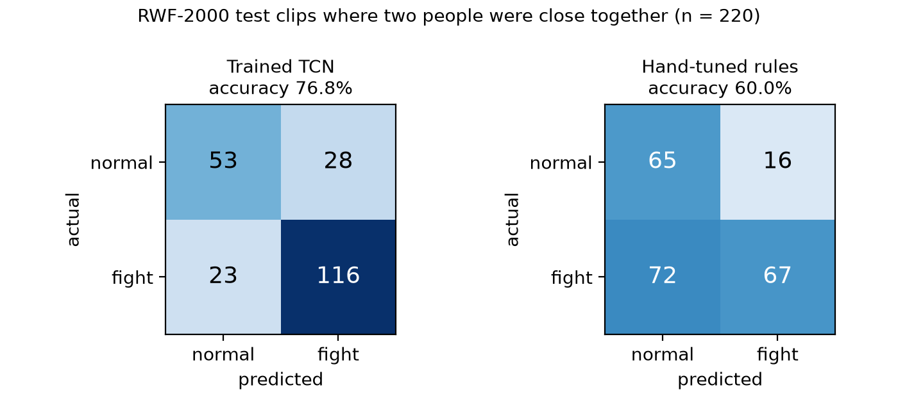

# Training the fight model (MLOps pipeline)

The fight detector is a **trained model**: a small neural network (GRU, TCN or ST-GCN) that reads the skeletons of two nearby people over 2 seconds and outputs the probability that they are fighting. This page explains what it learns from, how to retrain it, and how to add your own rover recordings.

## 1. The pipeline

```
Hugging Face ─► ingest ─► lake: datasets/ ─► extract_pose ─► lake: raw/ ─► validate ─► lake: validated/ ─► features ─► lake: processed/
 RWF-2000        SHA-256    (12 GB archive)    YOLO11n-pose +   skeletons     quality gate  (+ rejected/)       2 s windows   (feature windows)
                 verified                      ByteTrack 10 fps                                                              │
       ┌─────────────────────────────────────────────────────────────────────────────────────────────────────────────────────┘
       ▼
  train_fight ─► MLflow run + registry version @challenger ─► promote (beats @champion?) ─► registry pull ─► models/fight_model.onnx ─► rover
  CV, test, ONNX        (params, metrics, plots, model)          promotion gate                 deploy
```

| Stage | Script | Input | Output | Time (laptop CPU) |
|---|---|---|---|---|
| ingest | `training/ingest.py` | Hugging Face URL + SHA-256 in `params.yaml` | `s3://datasets/rwf2000/RWF-2000.tar.gz`, `data/manifests/rwf2000.json` | download time (12 GB) |
| extract_pose | `training/extract_pose.py` | the archive | `data/raw/pose/rwf2000/<split>/<Fight\|NonFight>/*.npz`, copied to `s3://raw/` | ~2–3 h |
| validate | `training/validate_data.py` | the raw skeletons | `data/validated/...` (+ `s3://validated/`, `s3://rejected/`), `reports/data_validation.json`, `reports/data_profile.json` | ~1 min |
| features | `training/features.py` | the validated skeletons | `data/processed/fight/rwf2000/` (training windows + per-pair evaluation windows), copied to `s3://processed/` | ~4 min |
| train_fight | `training/train_fight.py` | the feature windows + `params.yaml` | `models/candidate/model.{pt,onnx,json}`, metrics, plots, MLflow run, registry version `@challenger` | GRU ~10 min, ST-GCN ~1 h |
| (tuning) | `training/tune_fight.py` | the feature windows | best settings per architecture, `reports/tuning_<arch>.json`, one MLflow run per trial | 1–3 h |
| (promote) | `python -m mlops.registry promote` | challenger vs champion | `@champion` alias moves only if the challenger is better, `reports/promotion.json` | seconds |

All settings live in `params.yaml`; `dvc.yaml` chains the stages, so `dvc repro` re-runs only what changed. Data and model versions are stored in the data lake with `dvc push` (bucket `dvc`), and each training run is logged to the MLflow server.

**Data quality gate (validate stage).** Every clip is checked against a data contract: required fields, array shapes, finite values, confidences in [0, 1], valid boxes inside the frame, no duplicate detections, at least 2 s long. Broken clips go to the `rejected` zone with a `.reason.json`. Then the whole dataset is checked: reject rate below 5 %, enough clips per class, class balance, and no clip in both train and test (leakage). If a blocking check fails, the pipeline stops and no model is trained on bad data. The same run writes `reports/data_profile.json`, the reference distribution that drift monitoring compares live data against.

## 2. Why skeletons, not pixels

Stage 1 turns every clip into the **same skeletons the live system sees** (same YOLO11n-pose, same ByteTrack tracker, same 10 fps). So the model learns from exactly the kind of input it gets on the rover. Skeletons also ignore background, clothing and camera, which matters because RWF-2000 was filmed by fixed CCTV and the rover's camera is low and moving. And they are tiny, so the GRU trains in minutes on a CPU.

## 3. What one training sample is

- **Two people** who are close to each other: closer than `features.proximity` body-widths (5) and both tracked for at least `features.min_cover` of the window (30%). Both values are stored in the model's `.json`, so live detection uses exactly the rule the model was trained with.
- **20 frames = 2 seconds** at 10 fps.
- For each person and frame:
  - the position of all 17 keypoints relative to the pair's centre, divided by body width;
  - which keypoints are visible;
  - how fast each keypoint moves **relative to that person's own body** (walking moves the whole body and cancels out; punching moves arms against the body).
- For the pair: the distance between the two people and how fast it changes.
- That's **174 numbers per frame**, so one sample is a 20 × 174 table.
- **Label:** 1 if the clip is from RWF-2000 `Fight`, 0 if from `NonFight`.

**Augmentation** (more variety from the same data, training only):
- mirror left/right and swap which person is "A" (precomputed by the features stage);
- small random noise on every feature;
- **joint dropout:** whole joints are removed for the 2 s, the way the pose model misses a wrist in a dark or blurry frame;
- **time stretch:** the window is slowed down (the last 75–100 % replayed over 2 s, velocities scaled down), so the model also sees slower movements.

## 4. The models

Three architectures read the same 20 × 174 window and output one probability (`rover_ai/nets.py`). Pick one with `fight_model.arch` in `params.yaml`; live detection, ONNX export and the registry work the same for all of them.

| Architecture | Idea | Parameters |
|---|---|---|
| **GRU** (baseline) | Linear 174→64 + ReLU → GRU (2 layers) → [last state, mean state] → 1 | ~69 k |
| **TCN** (current champion) | 1-D convolutions over time with dilations 1, 2, … (sees the whole 2 s at once, fast on CPU); tuned: 32 channels, 2 levels | ~20 k (tuned) |
| **ST-GCN** | Graph convolution over the **34 joints of both people** (Yan et al., 2018): edges follow each skeleton, plus "contact" edges between one person's hands/feet and the other's head/torso, plus learned edges; then convolution over time | ~45 k |

Every trained model is also exported to **ONNX** (checked against PyTorch to 0.001), so it runs with ONNX Runtime, without PyTorch: smaller, faster, and the same file for the laptop, the serving API and a cloud VM.

**Live**, for every close pair of people in every frame: resample their last 2 s of skeletons to 10 fps, run the model in both person orders and average. Then alert when the pair's **last few judgements are all above the threshold** (how many, and the threshold, are chosen in training: see section 5). Detection flickers during fast movement, so a pair keeps this history through gaps of up to 1 s instead of starting again at every missed frame.

## 5. How it is trained and tested (no cheating)

| Data | Clips | Used for |
|---|---|---|
| RWF-2000 `train`, 5-fold cross-validation | 1,600 | choosing the **alert rule** (threshold + judgements in a row): each clip is scored by a model trained on the other 4 folds |
| RWF-2000 `train`, 90% / 10% ("dev") | 1,440 / 160 | fitting the final network / choosing its best epoch |
| RWF-2000 `val` | 400 | **final test only**: never seen during training or rule choice |

- **Loss:** binary cross-entropy (balanced for class sizes). **Optimiser:** AdamW, learning rate 0.001. **Batch:** 128.
- **Early stopping:** stop when the dev score hasn't improved for 8 epochs, and keep the best epoch.
- **Why cross-validation for the rule:** only clips where two people are detected close together can be affected by the threshold. In a 160-clip dev set that is about 65 clips, far too few to pick a threshold reliably. Cross-validation scores all 1,600 training clips (about 700 with a pair) without ever using the test set.
- **Clip-level test, scored the way it runs live:** a clip counts as "fight" if any close pair triggers the alert rule.
- **Baseline:** the same 400 test clips are replayed through the old hand-tuned rules, so both approaches are compared on identical data.

## 6. Results

Latest champion: **fight-detector v4, TCN** (numbers from `reports/fight_metrics.json` and the MLflow registry).

**How we got there** (every step is an MLflow run and a registry version, `python -m mlops.registry list`):

| Version | Change | Test F1 | Test ROC AUC | Fights found | Promotion |
|---|---|---|---|---|---|
| v1 | GRU baseline | 0.596 | 0.668 | 96 / 200 | first champion |
| v2 | TCN, same features | 0.602 | 0.671 | 96 / 200 | – |
| v3 | ST-GCN (best on clips with a pair: AUC 0.804), 51 min to train | 0.602 | 0.674 | 96 / 200 | **rejected**: F1 +0.006, needs +0.01 |
| v4 | TCN **tuned with Optuna** (40 trials) + **looser pairing** (`min_cover` 0.5→0.3, `proximity` 3.5→5) | **0.674** | **0.721** | **116 / 200** | **promoted**: F1 +0.078, AUC +0.053 |

What made the difference:
- **Coverage.** v1–v3 differ little because the architecture was not the bottleneck: 81 of the 200 test fights never had a close pair to judge. Accepting people tracked for 30% of the window (detection flickers on dark CCTV) and a slightly larger distance covers 139 fights (was 119) for 81 normal clips (was 72).
- **Tuning.** The best Optuna trial is a *small* TCN (32 channels, 2 levels, ~20 k parameters) with strong augmentation (joint dropout 0.19, time stretch 0.25). Bigger models scored better on single windows but worse on whole clips: they overfit RWF-2000. Cross-validated clip AUC: 0.742 vs. 0.727 for the default settings (`reports/tuning_tcn.json`).

**Alert rule chosen by 5-fold cross-validation:** 2 judgements in a row with probability ≥ **0.67** (out-of-fold F1 0.751 on training clips with a close pair).

**Final test on the 400 RWF-2000 `val` clips** (never used for training, tuning or choosing the rule), learned model vs. the old hand-tuned rules on the same clips:

| Metric | Learned, all 400 | Rules, all 400 | Learned, 220 with a pair | Rules, 220 with a pair |
|---|---|---|---|---|
| Accuracy | **72.0%** | 63.7% | **76.8%** | 60.0% |
| Precision | 80.6% | 81.6% | 80.6% | 80.7% |
| Recall (fights found) | **58.0%** | 35.5% | **83.5%** | 48.2% |
| F1 | **0.674** | 0.495 | **0.820** | 0.604 |
| ROC AUC | 0.721 | – | 0.804 | – |
| False alarms | 28 of 200 | 16 of 200 | 28 of 81 | 16 of 81 |

**How to read this:**
- The model finds far more fights than the rules (116 vs. 71 of 200) at the same precision (~81%: 4 of 5 alerts are real fights). Raise `model_threshold` if you want fewer alarms.
- **Coverage is still the main limit.** 61 test fights have no close pair at all: RWF-2000 is dark, blurry, crowded, top-down CCTV, and the pretrained pose model misses people there. No skeleton method can catch a fight it can't see. On the rover the camera is at person height and 2–4 m away, so people are much easier to detect.
- **Known false alarm:** two people walking *shoulder to shoulder*, overlapping in the image (`tests/videos/walking.avi` at 54 s; every version so far does this). RWF-2000 has few such normal clips. Labelled rover clips of people walking together (section 8) are the fix.
- These are numbers for CCTV footage. Measure the rover's real performance with the acting tests in `SETUP_GUIDE.md` part F.6 and `TESTING.md`.

Plots: training curves (`reports/fight_training.png`), confusion matrices (`reports/fight_confusion.png`), ROC curve with the rules as a dot (`reports/fight_roc.png`).




## 7. Retraining, step by step

The Docker stack must be running (`docker compose up -d`), so the lake and MLflow are reachable.

```bash
source .venv/bin/activate          # Windows: venv\Scripts\activate
python tools/configure_dvc.py      # once: DVC remote = the lake (bucket "dvc"), keys from .env

dvc repro                          # ingest -> extract_pose -> validate -> features -> train_fight (only what changed)
python -m mlops.registry promote   # the new @challenger replaces @champion only if it is better
python -m mlops.registry pull      # deploy the champion: models/fight_model.onnx/.pt/.json
dvc push                           # store this data/model version in the lake
python -m mlops.registry list      # every version with its test metrics and aliases
```

On another machine (e.g. the 16 GB laptop or a cloud VM): `git pull && dvc pull` gives exactly the same data and feature versions, and `python -m mlops.registry pull` gives the deployed model. Pose extraction is resumable: stop it and run `dvc repro` again to continue.

**Experiments.** `python training/train_fight.py --arch stgcn` trains another architecture (logged and registered like any run). `python training/tune_fight.py --arch gru --trials 30` searches the best settings with Optuna, using cross-validation on the train split only (the test clips are never used for tuning); copy the winner from `reports/tuning_gru.json` into `params.yaml` and run `dvc repro train_fight`. Compare runs side by side in the MLflow UI (http://localhost:5000, experiment `fight-model`).

**Promotion gate** (`params.yaml`, section `registry`): the challenger must beat the champion's test F1 by at least 0.01 without losing more than 0.02 ROC AUC. Rejected versions stay in the registry with the reason as a tag. Rollback: `python -m mlops.registry set-alias champion <old version>` and `pull` again.

## 8. Adding your own rover clips (makes it better on the rover)

1. Record with the rover: `python run.py --record outputs/fight_01.mp4` (raw video, steady 10 fps).
2. Cut each recording into short clips (3–10 s) and sort them into folders:
   ```
   data/own/train/Fight/fight_01.mp4       data/own/train/NonFight/walk_01.mp4
   data/own/val/Fight/fight_09.mp4         data/own/val/NonFight/talk_04.mp4
   ```
   Put about 1 in 5 clips in `val`. Keep clips of the same people/session in the same split.
3. Extract the skeletons: `python training/extract_pose.py --folder data/own --out data/raw/pose/own`
4. Check them: `python training/validate_data.py --input data/raw/pose/own --output data/validated/pose/own`
5. In `params.yaml`, set `features.extra_data: [data/validated/pose/own]`.
6. Retrain and compare: `dvc repro` then `python -m mlops.registry promote`.

The dashboard's **real / false alarm** labels tell you which alerts to turn into new `Fight` / `NonFight` clips. That's the retraining loop of the MLOps pipeline.

## 9. Using or switching off the model

`config.yaml`:
```yaml
fight:
  method: model              # or: rules  (the old hand-tuned thresholds)
  model: models/fight_model.onnx   # the registry champion (python -m mlops.registry pull); a .pt file also works
  model_threshold: null      # null = the threshold chosen in training; lower = more sensitive
  model_consecutive: null   # null = the number chosen in training
```
If the model file is missing, the app prints a message and uses the rules. At start-up it prints which registry version it runs, e.g. `trained GRU fight_model.onnx (fight-detector v1 (champion), threshold 0.73)`.
